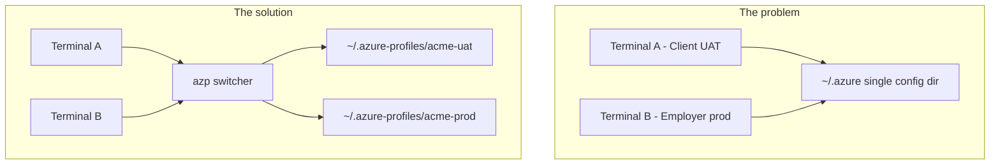
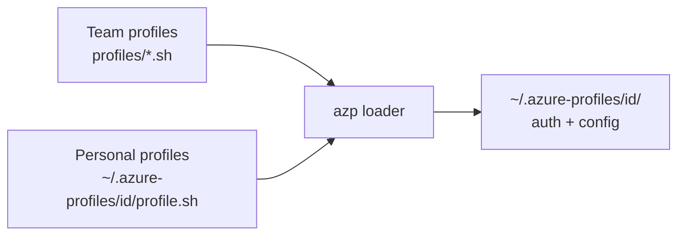

## The problem

I work across more than one Azure accouts on any given day: a client UAT subscription, a production environment I touch rarely, and sometimes a personal  account. If you have done the same, you know the friction.

The Azure CLI stores almost everything that defines "who you are" and "where you are working" in one place: `~/.azure`. When I run `az login` or `az account set`, I am not just picking a subscription for one terminal — I am changing shared global state. Open three terminals, forget which one you switched last, run a deploy script, and you can end up pointed at the wrong resource group. AWS solved this years ago with `AWS_PROFILE`. Azure has pieces of the puzzle, but nothing equally easy to remember.

I'm sharing the small tool I built to fix that for myself: **`azp`**, a shell function that switches isolated Azure CLI profiles the way `AWS_PROFILE` switches AWS credentials — using separate config directories and one short command.

---

## What Azure gives you today

Before building anything custom, it is worth understanding what Microsoft already documents in the [Azure CLI configuration guide](https://learn.microsoft.com/en-us/cli/azure/azure-cli-configuration?view=azure-cli-latest).

**`az config set`** — sets defaults such as resource group, location, and output format. Helpful, but still within a single config directory.

**`az account set --subscription …`** — switches the active subscription. Again, one shared `~/.azure` unless you tell the CLI otherwise.

**`AZURE_CONFIG_DIR`** — this is the key. It controls where the CLI reads and writes config, tokens, and session data. Default on macOS and Linux: `~/.azure`. Point it somewhere else and you get a fully separate CLI identity.

Configuration precedence (highest wins):

1. Command-line flags  
2. Environment variables (`AZURE_*`)  
3. Values in `$AZURE_CONFIG_DIR/config`

**The insight that changed my workflow:** isolation means separate `AZURE_CONFIG_DIR` folders — not just `az account set` on a shared config.



---

## How I iterated to a solution

I did not get this right on the first try. The evolution looked like this:

| Phase | Approach | Limitation |
|-------|----------|------------|
| 1. Workspace-scoped | `export AZURE_CONFIG_DIR=$PWD/.azure` per project | Only applies when you are in that repo and remember to set it |
| 2. Global profile dirs | `~/.azure-profiles/<name>` + shell aliases | Works everywhere, but aliases multiply (`az-client-uat`, `az-acme-prod`, …) |
| 3. **`azp` command** | One memorable CLI with an interactive picker | Final form — one thing to remember |

The goal of `azp` is simple: **switch context in any terminal with one command**, without memorizing a matrix of aliases.

---

## Architecture

Each profile is a directory under `~/.azure-profiles/<profile-id>/`. That directory holds:

- **Auth and CLI state** — tokens, `config`, MSAL cache (created by `az login`)
- **`profile.sh`** (optional) — metadata for user-created profiles

Profile *definitions* can come from two places:



- **Team profiles** — small metadata files checked into a repo (e.g. `tools/azure/profiles/acme-uat.sh`). Everyone gets the same defaults.
- **Personal profiles** — created locally with `azp create`. Never committed; they live only in your home directory.
- **Duplicate IDs** — if both repo and home define the same profile id, the repo version wins.

Each profile file is metadata only — no boilerplate functions required. A generic setup routine handles login configuration: pick the right subscription (or auto-detect it by resource group access), then set `az config` defaults.

---

## Step-by-step setup

### Step 1 — Prerequisites

- [Azure CLI](https://learn.microsoft.com/en-us/cli/azure/install-azure-cli) installed (`az version`)
- **zsh** (the script below is written for zsh; bash is a straightforward port)
- A shell config file you control (`~/.zshrc`)

### Step 2 — Create the profile root

```bash
mkdir -p ~/.azure-profiles
```

### Step 3 — Add the `azp` script

I keep the switcher in my dotfiles (or a `tools/azure/` folder in a shared repo):

```
tools/azure/
  azp.sh                 # main switcher (~500 lines)
  profiles/
    acme-uat.sh          # optional team profile (metadata only)
```

Source it from `~/.zshrc`:

```bash
source ~/dotfiles/azure/azp.sh
# or: source /path/to/tools/azure/azp.sh
```

Reload your shell: `source ~/.zshrc`.


### Step 4 — Define a team profile (metadata only)

This is the piece I wish I had seen documented earlier. A profile can be five lines:

```bash
# tools/azure/profiles/acme-uat.sh
AZP_PROFILE_ID="acme-uat"
AZP_PROFILE_LABEL="Acme UAT"
AZP_PROFILE_RESOURCE_GROUP="rg-portal-uat"
AZP_PROFILE_WEB_APP="portal-uat"
AZP_PROFILE_SUBSCRIPTION=""
```

Leave `AZP_PROFILE_SUBSCRIPTION` empty and the setup logic scans your accessible subscriptions for one that can read the resource group. Set it to a subscription GUID or display name when you want a fixed target.

### Step 5 — Log in to a profile

```bash
azp login acme-uat
```

Under the hood:

1. `export AZURE_CONFIG_DIR=~/.azure-profiles/acme-uat`
2. `az login` (browser / MFA)
3. Subscription selection (fixed or auto-detected via resource group)
4. `az config set defaults.group=… defaults.web=… core.output=table`

### Step 6 — Switch profiles from any terminal

```bash
azp                  # interactive menu — pick a number
azp acme-uat         # switch directly
azp list             # list profiles and show which is active
azp off              # return to default ~/.azure
```

After switching, every `az …` command in that terminal uses the active profile automatically.

Example interactive menu:

```text
Select Azure profile:
  0) default (~/.azure)
  1) acme-uat - Acme UAT
  2) acme-prod - Acme Prod
Choice:
```

### Step 7 — Create a new profile interactively

```bash
azp create acme-prod
```

You will be prompted for:

| Field | Required | Purpose |
|-------|----------|---------|
| Profile ID | Yes | Directory name; lowercase, numbers, hyphens |
| Label | Yes | Shown in the menu |
| Resource group | No | Auto-detect subscription |
| Web app | No | Sets `defaults.web` |
| Subscription | No | Skip auto-detect if you know the sub |

The wizard writes `~/.azure-profiles/acme-prod/profile.sh`:

```bash
# Created by azp create on 2026-05-25 12:00:00
AZP_PROFILE_ID="acme-prod"
AZP_PROFILE_LABEL="Acme Prod"
AZP_PROFILE_RESOURCE_GROUP="rg-portal-prod"
AZP_PROFILE_WEB_APP="portal-prod"
AZP_PROFILE_SUBSCRIPTION=""
```

It then asks whether to log in immediately. You can defer with `n` and run `azp login acme-prod` later.

### Step 8 — Verify before destructive work

```bash
azp acme-uat
azp verify
az account show
```

`azp verify` prints the active subscription and, when configured, checks that the resource group and web app are reachable. I run this before slot swaps, deploys, or bulk deletes.

### Step 9 — Built-in help

```bash
azp --help
# also: azp help, azp -h
```

---

## Command reference

| Command | Description |
|---------|-------------|
| `azp` | Interactive profile picker |
| `azp list` | List repo + user profiles; show active profile |
| `azp create [id]` | Create a profile under `~/.azure-profiles/` |
| `azp <profile>` | Switch to profile (e.g. `azp acme-uat`) |
| `azp login [profile]` | Log in and apply subscription/defaults |
| `azp verify` | Validate access for the active profile |
| `azp off` | Switch back to default `~/.azure` |
| `azp help` | Usage, examples, and tips |

**Environment variables set when a profile is active:**

| Variable | Value |
|----------|-------|
| `AZURE_CONFIG_DIR` | `~/.azure-profiles/<profile-id>/` |
| `AZP_ACTIVE_PROFILE` | Profile id (e.g. `acme-uat`) |

---

## AWS vs Azure comparison

If you already think in AWS terms, this table maps cleanly:

| AWS | Azure with `azp` |
|-----|------------------|
| `~/.aws/credentials` + `~/.aws/config` | `~/.azure-profiles/<id>/` |
| `export AWS_PROFILE=uat` | `azp uat` (sets `AZURE_CONFIG_DIR`) |
| `aws s3 ls --profile uat` | Switch once per terminal; then plain `az …` |
| Named profiles in config files | Metadata in `profile.sh` + isolated config dirs |

Azure CLI commands do not take a universal `--profile` flag the way AWS does. **`azp` is the profile switch** — set it once in the terminal session and forget it.

---

## Tips and troubleshooting

**MFA and multi-tenant accounts** — `az login` may warn that some tenants need separate authentication. Complete sign-in in the browser with the account that has access to the subscription you need.

**Subscription names are inconsistent** — CI/CD service connection names in Azure DevOps often differ from names in `az account list`. When in doubt, use the subscription GUID: `az account set --subscription "<guid>"` or set `AZP_PROFILE_SUBSCRIPTION` in the profile file.

**Use `azp off` when leaving Azure work** — other tools may assume the default `~/.azure`. Switch back before running them.

**Do not commit profile directories** — `~/.azure-profiles/<id>/` contains tokens and secrets. Only commit small metadata files under `tools/azure/profiles/` if you use team profiles.

**Terraform / Pulumi / SDKs** — switching `azp` changes the Azure CLI context. Infrastructure tools may use their own env vars (`ARM_SUBSCRIPTION_ID`, etc.). Set those explicitly if your pipeline does not read from the CLI.

**Repo profile overrides home** — if you define `acme-uat` in both places, the repo definition wins. Keep ids unique or intentional.

**Prompt integration** — export `AZP_ACTIVE_PROFILE` is set by design. I display it in my prompt so I always know which Azure world I am in:

```bash
# example zsh prompt snippet
[[ -n "$AZP_ACTIVE_PROFILE" ]] && echo "az:$AZP_ACTIVE_PROFILE"
```

---

What I got out of it:

- **One command to remember** — `azp` instead of a growing list of aliases  
- **Safer switching** — UAT and prod credentials do not share one config directory  
- **Extensible** — `azp create` for ad-hoc clients; repo metadata for team standards  
- **Discoverable** — `azp --help` and `azp list` when you forget what exists  


---

## Appendix

### File layout

```
~/.azure-profiles/
  acme-uat/                    # created on first login
    profile.sh                 # optional; from azp create
    config                     # az config (defaults.group, etc.)
    azureProfile.json          # subscription list
    msal_*                     # auth tokens (do not commit)

tools/azure/                   # in dotfiles or team repo
  azp.sh
  profiles/
    acme-uat.sh                # team metadata (safe to commit)
```

### Minimal `azp` skeleton (conceptual)

The production script adds profile discovery, generic setup/verify, and the create wizard. The core switch is only a few lines:

```bash
azp_switch() {
  export AZURE_CONFIG_DIR="$HOME/.azure-profiles/$1"
  export AZP_ACTIVE_PROFILE="$1"
  mkdir -p "$AZURE_CONFIG_DIR"
  az account show -o table 2>/dev/null || echo "Run: azp login $1"
}
```

### full script 
```bash
#!/usr/bin/env zsh
# Global Azure CLI profile switcher (AWS_PROFILE-style via AZURE_CONFIG_DIR).
#
# Add to ~/.zshrc:
#   source "/path/to/tools/azure/azp.sh"
#
# Usage:
#   azp              # interactive profile picker
#   azp list         # list profiles
#   azp create [id]  # create a new profile in ~/.azure-profiles/
#   azp acme-uat     # switch directly
#   azp login        # login + configure (interactive pick if no name)
#   azp verify       # verify active profile access
#   azp help         # show usage, examples, and tips

AZP_ROOT_DIR="${HOME}/.azure-profiles"
AZP_SCRIPT_DIR="${${(%):-%x}:a:h}"
AZP_PROFILES_DIR="${AZP_SCRIPT_DIR}/profiles"

typeset -a AZP_PROFILE_IDS
typeset -A AZP_PROFILE_LABELS
typeset -A AZP_PROFILE_SETUP
typeset -A AZP_PROFILE_VERIFY
typeset -A AZP_PROFILE_RESOURCE_GROUPS
typeset -A AZP_PROFILE_WEB_APPS
typeset -A AZP_PROFILE_SUBSCRIPTIONS
typeset -A AZP_LOADED_IDS

_azp_register_profile() {
  local id="${AZP_PROFILE_ID}"
  local label="${AZP_PROFILE_LABEL:-${id}}"
  local fn_id="${id//-/_}"

  AZP_PROFILE_IDS+=("${id}")
  AZP_PROFILE_LABELS[$id]="${label}"
  AZP_PROFILE_RESOURCE_GROUPS[$id]="${AZP_PROFILE_RESOURCE_GROUP:-}"
  AZP_PROFILE_WEB_APPS[$id]="${AZP_PROFILE_WEB_APP:-}"
  AZP_PROFILE_SUBSCRIPTIONS[$id]="${AZP_PROFILE_SUBSCRIPTION:-}"

  if (( $+functions[azp_profile_${fn_id}_setup] )); then
    AZP_PROFILE_SETUP[$id]="azp_profile_${fn_id}_setup"
  fi
  if (( $+functions[azp_profile_${fn_id}_verify] )); then
    AZP_PROFILE_VERIFY[$id]="azp_profile_${fn_id}_verify"
  fi

  unset AZP_PROFILE_ID AZP_PROFILE_LABEL AZP_PROFILE_RESOURCE_GROUP AZP_PROFILE_WEB_APP AZP_PROFILE_SUBSCRIPTION AZP_PROFILE_TENANT_HINT
}

_azp_load_profiles() {
  AZP_PROFILE_IDS=()
  AZP_PROFILE_LABELS=()
  AZP_PROFILE_SETUP=()
  AZP_PROFILE_VERIFY=()
  AZP_PROFILE_RESOURCE_GROUPS=()
  AZP_PROFILE_WEB_APPS=()
  AZP_PROFILE_SUBSCRIPTIONS=()
  AZP_LOADED_IDS=()

  local profile_file
  for profile_file in "${AZP_PROFILES_DIR}"/*.sh(N); do
    source "${profile_file}"
    if [[ -n "${AZP_LOADED_IDS[$AZP_PROFILE_ID]:-}" ]]; then
      unset AZP_PROFILE_ID AZP_PROFILE_LABEL AZP_PROFILE_RESOURCE_GROUP AZP_PROFILE_WEB_APP AZP_PROFILE_SUBSCRIPTION AZP_PROFILE_TENANT_HINT
      continue
    fi
    _azp_register_profile
    AZP_LOADED_IDS[$AZP_PROFILE_ID]=1
  done

  for profile_file in "${AZP_ROOT_DIR}"/*/profile.sh(N); do
    source "${profile_file}"
    if [[ -n "${AZP_LOADED_IDS[$AZP_PROFILE_ID]:-}" ]]; then
      unset AZP_PROFILE_ID AZP_PROFILE_LABEL AZP_PROFILE_RESOURCE_GROUP AZP_PROFILE_WEB_APP AZP_PROFILE_SUBSCRIPTION AZP_PROFILE_TENANT_HINT
      continue
    fi
    _azp_register_profile
    AZP_LOADED_IDS[$AZP_PROFILE_ID]=1
  done
}

_azp_profile_dir() {
  echo "${AZP_ROOT_DIR}/${1}"
}

_azp_use_profile() {
  local profile_id="$1"
  export AZURE_CONFIG_DIR="$(_azp_profile_dir "${profile_id}")"
  export AZP_ACTIVE_PROFILE="${profile_id}"
  mkdir -p "${AZURE_CONFIG_DIR}"
}

_azp_use_default() {
  unset AZURE_CONFIG_DIR
  unset AZP_ACTIVE_PROFILE
  echo "Using default Azure CLI config: ${HOME}/.azure"
  if az account show >/dev/null 2>&1; then
    az account show -o table
  else
    echo "Not logged in to default profile. Run: az login"
  fi
}

_azp_find_profile() {
  local needle="$1"
  local id

  for id in "${AZP_PROFILE_IDS[@]}"; do
    if [[ "${id}" == "${needle}" ]]; then
      return 0
    fi
  done

  return 1
}

_azp_validate_profile_id() {
  [[ "${1}" =~ ^[a-z0-9]+(-[a-z0-9]+)*$ ]]
}

_azp_profile_exists() {
  local profile_id="$1"

  if [[ -f "$(_azp_profile_dir "${profile_id}")/profile.sh" ]]; then
    return 0
  fi

  if [[ -f "${AZP_PROFILES_DIR}/${profile_id}.sh" ]]; then
    return 0
  fi

  return 1
}

_azp_run_profile_setup() {
  local profile_id="$1"
  local setup_fn="${AZP_PROFILE_SETUP[$profile_id]}"

  if [[ -n "${setup_fn}" ]]; then
    "${setup_fn}" || return 1
  elif [[ -n "${AZP_PROFILE_RESOURCE_GROUPS[$profile_id]:-}" || -n "${AZP_PROFILE_SUBSCRIPTIONS[$profile_id]:-}" ]]; then
    _azp_generic_setup "${profile_id}" || return 1
  else
    az config set core.output=table >/dev/null
  fi
}

_azp_run_profile_verify() {
  local profile_id="$1"
  local verify_fn="${AZP_PROFILE_VERIFY[$profile_id]}"

  if [[ -n "${verify_fn}" ]]; then
    "${verify_fn}"
  elif [[ -n "${AZP_PROFILE_RESOURCE_GROUPS[$profile_id]:-}" ]]; then
    _azp_generic_verify "${profile_id}"
  fi
}

_azp_generic_setup() {
  local profile_id="$1"
  local resource_group="${AZP_PROFILE_RESOURCE_GROUPS[$profile_id]:-}"
  local web_app="${AZP_PROFILE_WEB_APPS[$profile_id]:-}"
  local subscription="${AZP_PROFILE_SUBSCRIPTIONS[$profile_id]:-}"
  local sub_id sub_name
  local -a config_args=()

  if [[ -n "${subscription}" ]]; then
    az account set --subscription "${subscription}" || return 1
    echo "Using subscription: ${subscription}"
  elif [[ -n "${resource_group}" ]]; then
    echo "Searching for a subscription with access to ${resource_group}..."

    while IFS=$'\t' read -r sub_id sub_name; do
      [[ -z "${sub_id}" ]] && continue
      az account set --subscription "${sub_id}" >/dev/null 2>&1 || continue
      if az group show --name "${resource_group}" >/dev/null 2>&1; then
        echo "Using subscription: ${sub_name} (${sub_id})"
        break
      fi
    done < <(az account list --query "[].{id:id, name:name}" -o tsv 2>/dev/null)

    if ! az group show --name "${resource_group}" >/dev/null 2>&1; then
      echo "Could not find a subscription with access to ${resource_group}." >&2
      az account list --query "[].{Name:name, SubscriptionId:id, IsDefault:isDefault}" -o table >&2
      return 1
    fi
  fi

  [[ -n "${resource_group}" ]] && config_args+=(defaults.group="${resource_group}")
  [[ -n "${web_app}" ]] && config_args+=(defaults.web="${web_app}")
  config_args+=(core.output=table)

  if (( ${#config_args[@]} > 0 )); then
    az config set "${config_args[@]}" >/dev/null
  fi
}

_azp_generic_verify() {
  local profile_id="$1"
  local resource_group="${AZP_PROFILE_RESOURCE_GROUPS[$profile_id]:-}"
  local web_app="${AZP_PROFILE_WEB_APPS[$profile_id]:-}"

  if [[ -n "${resource_group}" ]]; then
    az group show --name "${resource_group}" \
      --query "{Name:name, Location:location, ProvisioningState:properties.provisioningState}" -o table
  fi

  if [[ -n "${web_app}" && -n "${resource_group}" ]]; then
    az webapp show --name "${web_app}" --resource-group "${resource_group}" \
      --query "{Name:name, State:state, DefaultHostName:defaultHostName}" -o table
  fi
}

_azp_pick_profile() {
  local prompt="${1:-Select Azure profile}"
  local choice id label i

  if (( ${#AZP_PROFILE_IDS[@]} == 0 )); then
    echo "No azp profiles found. Run: azp create" >&2
    return 1
  fi

  echo "${prompt}:"
  echo "  0) default (~/.azure)"
  i=1
  for id in "${AZP_PROFILE_IDS[@]}"; do
    label="${AZP_PROFILE_LABELS[$id]}"
    echo "  ${i}) ${id} - ${label}"
    (( i++ ))
  done

  read "choice?Choice: "
  if [[ "${choice}" == "0" ]]; then
    _azp_use_default
    return 0
  fi

  if [[ ! "${choice}" =~ ^[0-9]+$ ]] || (( choice < 1 || choice > ${#AZP_PROFILE_IDS[@]} )); then
    echo "Invalid choice." >&2
    return 1
  fi

  id="${AZP_PROFILE_IDS[$choice]}"
  _azp_switch_profile "${id}"
}

_azp_switch_profile() {
  local profile_id="$1"

  if ! _azp_find_profile "${profile_id}"; then
    echo "Unknown profile: ${profile_id}" >&2
    echo "Run: azp list" >&2
    return 1
  fi

  _azp_use_profile "${profile_id}"

  if ! az account show >/dev/null 2>&1; then
    echo "Profile '${profile_id}' is not logged in yet. Run: azp login ${profile_id}" >&2
    return 1
  fi

  echo "Active profile: ${profile_id} (${AZP_PROFILE_LABELS[$profile_id]})"
  echo "Config dir: ${AZURE_CONFIG_DIR}"
  az account show -o table
}

_azp_login_profile() {
  local profile_id="$1"

  if ! _azp_find_profile "${profile_id}"; then
    echo "Unknown profile: ${profile_id}" >&2
    return 1
  fi

  _azp_use_profile "${profile_id}"

  if ! az account show >/dev/null 2>&1; then
    echo "Logging in to profile: ${profile_id}"
    az login || return 1
  fi

  _azp_run_profile_setup "${profile_id}" || return 1

  echo
  echo "Profile ready: ${profile_id}"
  az account show -o table
}

_azp_verify_profile() {
  local profile_id="${AZP_ACTIVE_PROFILE:-}"

  if [[ -z "${profile_id}" ]]; then
    echo "No azp profile active. Run: azp" >&2
    return 1
  fi

  if ! az account show >/dev/null 2>&1; then
    echo "Not logged in. Run: azp login ${profile_id}" >&2
    return 1
  fi

  echo "Profile: ${profile_id} (${AZP_PROFILE_LABELS[$profile_id]})"
  echo "Config dir: ${AZURE_CONFIG_DIR}"
  az account show -o table
  echo

  _azp_run_profile_verify "${profile_id}"
}

_azp_list_profiles() {
  local id

  echo "Available profiles:"
  echo "  default  ~/.azure"
  for id in "${AZP_PROFILE_IDS[@]}"; do
    echo "  ${id}  ${AZP_PROFILE_LABELS[$id]}"
  done

  if [[ -n "${AZP_ACTIVE_PROFILE:-}" ]]; then
    echo
    echo "Active: ${AZP_ACTIVE_PROFILE}"
  elif [[ -n "${AZURE_CONFIG_DIR:-}" ]]; then
    echo
    echo "Active config dir: ${AZURE_CONFIG_DIR}"
  else
    echo
    echo "Active: default (~/.azure)"
  fi
}

_azp_prompt_value() {
  local prompt="$1"
  local default_value="${2:-}"
  local value

  if [[ -n "${default_value}" ]]; then
    read "value?${prompt} [${default_value}]: "
    echo "${value:-${default_value}}"
  else
    read "value?${prompt}: "
    echo "${value}"
  fi
}

_azp_create_profile() {
  local profile_id="${1:-}"
  local label resource_group web_app subscription profile_dir profile_file login_now

  if [[ -z "${profile_id}" ]]; then
    profile_id="$(_azp_prompt_value "Profile ID (e.g. acme-prod)")"
  fi

  if ! _azp_validate_profile_id "${profile_id}"; then
    echo "Invalid profile ID '${profile_id}'. Use lowercase letters, numbers, and hyphens." >&2
    return 1
  fi

  if _azp_profile_exists "${profile_id}"; then
    echo "Profile '${profile_id}' already exists." >&2
    return 1
  fi

  label="$(_azp_prompt_value "Label" "${profile_id}")"
  resource_group="$(_azp_prompt_value "Resource group (optional)" "")"
  web_app="$(_azp_prompt_value "Web app name (optional)" "")"
  subscription="$(_azp_prompt_value "Subscription ID or name (optional)" "")"

  profile_dir="$(_azp_profile_dir "${profile_id}")"
  profile_file="${profile_dir}/profile.sh"
  mkdir -p "${profile_dir}"

  cat > "${profile_file}" <<EOF
# Created by azp create on $(date '+%Y-%m-%d %H:%M:%S')
AZP_PROFILE_ID="${profile_id}"
AZP_PROFILE_LABEL="${label}"
AZP_PROFILE_RESOURCE_GROUP="${resource_group}"
AZP_PROFILE_WEB_APP="${web_app}"
AZP_PROFILE_SUBSCRIPTION="${subscription}"
EOF

  echo "Created profile: ${profile_id}"
  echo "Profile file: ${profile_file}"

  read "login_now?Log in and configure now? [Y/n]: "
  case "${login_now:-Y}" in
    Y|y|"")
      _azp_load_profiles
      _azp_login_profile "${profile_id}"
      ;;
    *)
      echo "Run later: azp login ${profile_id}"
      ;;
  esac
}

_azp_show_help() {
  cat <<'EOF'
azp — Azure CLI profile switcher (AWS_PROFILE-style)

Switch between isolated Azure CLI contexts without touching ~/.azure.
Each profile stores its own login, subscription defaults, and config under:
  ~/.azure-profiles/<profile-id>/

Commands:
  azp                   Interactive menu to pick a profile
  azp list              List all profiles (repo + user-created)
  azp create [id]       Create a new profile in ~/.azure-profiles/
  azp <profile>         Switch to a profile (e.g. azp acme-uat)
  azp login [profile]   Log in and apply subscription/defaults
  azp verify            Check access for the active profile
  azp off               Return to default ~/.azure config
  azp help              Show this help

Profile sources:
  Repo (team):   tools/azure/profiles/*.sh
  User (local):  ~/.azure-profiles/*/profile.sh

Quick start — new profile:
  azp create acme-prod
  azp login acme-prod
  azp acme-prod
  azp verify

Quick start — existing profile:
  azp                     # pick from menu
  azp acme-uat            # or switch directly
  az account show         # uses active profile automatically

Create prompts:
  Profile ID        Required — lowercase, numbers, hyphens (e.g. acme-prod)
  Label             Display name shown in the menu
  Resource group    Optional — used to auto-detect the right subscription
  Web app           Optional — sets az config defaults.web
  Subscription      Optional — skip auto-detect if you know the sub ID/name

Environment (set automatically when a profile is active):
  AZURE_CONFIG_DIR    Points to ~/.azure-profiles/<profile-id>/
  AZP_ACTIVE_PROFILE  Current profile name

Tips:
  - Run `azp list` to see what's available and which profile is active
  - Repo profiles (like acme-uat) ship with the project; personal ones stay in ~
  - Use `azp off` before working on non-Azure projects that expect ~/.azure
  - After `azp create`, you can defer login and run `azp login <id>` later
  - `azp verify` checks resource group and web app access when configured

Examples:
  azp create                    # fully interactive wizard
  azp create my-client-uat      # pass profile id upfront
  azp login acme-uat            # authenticate + set UAT defaults
  azp verify                    # confirm RG and app service access
  az webapp list                # runs against the active profile
EOF
}

azp() {
  _azp_load_profiles

  case "${1:-}" in
    "")
      _azp_pick_profile
      ;;
    list|ls)
      _azp_list_profiles
      ;;
    create|new)
      _azp_create_profile "${2:-}"
      ;;
    off|default)
      _azp_use_default
      ;;
    login)
      if [[ -n "${2:-}" ]]; then
        _azp_login_profile "$2"
      else
        _azp_pick_profile "Select profile to log in to"
        if [[ -n "${AZP_ACTIVE_PROFILE:-}" ]]; then
          _azp_login_profile "${AZP_ACTIVE_PROFILE}"
        fi
      fi
      ;;
    verify|check)
      _azp_verify_profile
      ;;
    help|-h|--help)
      _azp_show_help
      ;;
    *)
      _azp_switch_profile "$1"
      ;;
  esac
}

_azp_load_profiles

```


### Further reading

- [Azure CLI configuration options](https://learn.microsoft.com/en-us/cli/azure/azure-cli-configuration?view=azure-cli-latest) — `AZURE_CONFIG_DIR`, env var naming, `az config`
- [Azure CLI installation](https://learn.microsoft.com/en-us/cli/azure/install-azure-cli)
